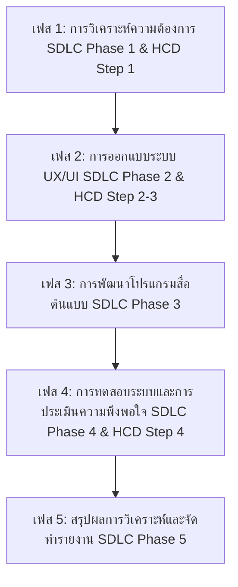

# เอกสารข้อเสนอโครงการวิจัยปริญญาตรี (Senior Project Proposal)

## ชื่อโครงการวิจัย
**ภาษาไทย:** นวัตกรรมโปรแกรมทำ Retopology อัตโนมัติสำหรับโมเดล 3 มิติ ด้วยอัลกอริทึม Curvature-Guided Quad-Flow Remeshing บนระบบ Web Application ด้วย Gradio  
**ภาษาอังกฤษ:** Interactive Web-Based 3D Mesh Retopology via Curvature-Guided Quad-Flow Remeshing Algorithm Powered by Gradio Web Framework

---

## บทที่ 1 บทนำ (Introduction)

### 1.1 หลักการและเหตุผล (Background & Rationale)
ในอุตสาหกรรมคอมพิวเตอร์กราฟิก 3 มิติ สื่อดิจิทัล เอนิเมชัน และการพัฒนาเกมยุคปัจจุบัน การสร้างโมเดลความละเอียดสูง (High-poly Model) ผ่านกระบวนการปั้น 3D Sculpting (เช่น ZBrush, Blender Sculpt) ถือเป็นขั้นตอนมาตรฐานในการสร้างสรรค์รายละเอียดที่สมจริง อย่างไรก็ตาม โมเดล High-poly มักประกอบด้วยโพลีกอนแบบสามเหลี่ยม (Triangles) จำนวนหลายล้านหน้า ซึ่งไม่สามารถนำไปใช้งานในเอนจินเกมแบบ Real-time, ระบบ Virtual Reality (VR), Augmented Reality (AR) หรือกระบวนการทำโครงกระดูกเพื่อการเคลื่อนไหว (Rigging & Animation) ได้โดยตรง เนื่องจากโครงสร้างเส้นที่ไม่เป็นระเบียบและภาระประมวลผล GPU ที่สูงเกินไป

กระบวนการ **Retopology (การทำโครงสร้างตาข่ายพิกัดใหม่)** จึงเป็นขั้นตอนสำคัญในการแปลงโมเดล High-poly ให้กลายเป็นโมเดล Low-poly ที่มีโครงสร้างรูปสี่เหลี่ยม (Quad-dominant Topology) พร้อมทิศทางเส้น (Edge Flow) ที่สอดคล้องกับสรีระ หรือส่วนโค้งเว้าของวัตถุ อย่างไรก็ตาม กระบวนการ Retopology แบบดั้งเดิมที่ทำด้วยมือ (Manual Retopology) ต้องใช้ทักษะความชำนาญสูงและใช้เวลาคิดเป็น 40%–60% ของระยะเวลาสร้างสรรค์ 3D Asset ทั้งหมด

แม้จะมีเครื่องมือลดโพลีกอนหรือจัดเส้นอัตโนมัติในปัจจุบัน (เช่น Instant Meshes, Quad Remesher, ZRemesher) แต่เครื่องมือเหล่านี้มักประสบปัญหาข้อจำกัดดังนี้:
1. **ขาดความยืดหยุ่นและการเข้าถึงบนเว็บ:** ซอฟต์แวร์ส่วนใหญ่เป็นแบบเดสก์ท็อปโปรแกรมเฉพาะ (Proprietary Desktop Software) ติดตั้งยาก และไม่สามารถบูรณาการเข้ากับระบบคลาวด์หรือเวิร์กโฟลว์บนเว็บไดนามิกได้
2. **ปัญหาบริเวณจุดบิดเบี้ยวและขอบขนาน (Feature Preserving & Singularities):** อัลกอริทึมอัตโนมัติเดิมมักสูญเสียรายละเอียดส่วนขอบคม (Hard Edges) หรือเกิดจุดยอดประหลาด (Poles/Singularities) ในบริเวณที่มีความโค้งบิดเบี้ยว
3. **ขาดระบบโต้ตอบในเวลาจริง (Real-time Interactive Web UI):** นักพัฒนาไม่สามารถปรับแก้สนามความโค้ง (Curvature Fields) หรือความหนาแน่นของ Quad แบบเรียลไทม์ผ่านเว็บเบราว์เซอร์ได้

งานวิจัยนี้จึงมุ่งพัฒนานวัตกรรมโปรแกรม Retopology อัตโนมัติเชิงโต้ตอบ โดยนำเสนอ **อัลกอริทึมใหม่: Curvature-Guided Quad-Flow Remeshing (CG-QFR)** ร่วมกับการพัฒนาส่วนต่อประสานผู้ใช้บนเว็บ (Web Application) ด้วยเฟรมเวิร์ก **Gradio** และ **Python Machine Learning/3D Mesh Libraries** เพื่อสร้างแพลตฟอร์มสื่อต้นแบบที่เปิดให้ใช้งานผ่านเว็บเบราว์เซอร์ได้อย่างรวดเร็ว แม่นยำ และเหมาะแก่การนำไปใช้อ้างอิงและตีพิมพ์ในวารสารวิชาการ

### 1.2 วัตถุประสงค์ของการวิจัย (Research Objectives)
1. **เพื่อศึกษา วิเคราะห์ และพัฒนานวัตกรรมโปรแกรมสื่อต้นแบบในรูปแบบ Web Application:** สำหรับจัดระเบียบโครงสร้างตาข่าย 3 มิติ (3D Retopology) และลดจำนวนโพลีกอนอย่างมีประสิทธิภาพผ่านเว็บเบราว์เซอร์
2. **เพื่อพัฒนาอัลกอริทึมใหม่ในการจัดระเบียบเมช 3 มิติ (Novel Retopology Algorithm):** อัลกอริทึม *Curvature-Guided Quad-Flow Remeshing (CG-QFR)* ที่รองรับการสกัดแนวขอบคม และแปลงโครงสร้างเป็นเฟสสี่เหลี่ยม (Quad-dominant Faces) หรือสามเหลี่ยม (Triangular Faces)
3. **เพื่อประเมินความพึงพอใจของผู้ใช้งานต่อสื่อต้นแบบ Web Application:** ประเมินคุณภาพและประสิทธิภาพของแอปพลิเคชันจากกลุ่มตัวอย่างผู้ใช้งาน

### 1.3 ขอบเขตการวิจัย (Scope of Research)
1. **ขอบเขตด้านเนื้อหาและเทคโนโลยี:**
   - มุ่งเน้นการพัฒนาระบบ Retopology และลดโพลีกอนบน Web Application ด้วย Gradio & Python
   - รองรับการแปลงโครงสร้างเมชสี่เหลี่ยม Quad และสามเหลี่ยม Triangle พร้อมโหมดแสดงผล Shade + Wireframe
   - รองรับระบบสมมาตรโมเดล 3 มิติ (3D Mesh Symmetry: ปิด, แกน X, แกน Y, แกน Z)
2. **ขอบเขตด้านไฟล์ข้อมูล 3D:**
   - นำเข้าไฟล์: `.OBJ`, `.FBX`, `.PLY`, `.STL`, `.GLTF`, `.GLB`
   - ส่งออกไฟล์: `.OBJ` (รองรับ Quad `f v1 v2 v3 v4`), `.FBX`, `.GLTF`, `.PLY`
3. **ขอบเขตด้านประชากรและกลุ่มตัวอย่าง:**
   - นิสิตคณะวิทยาการสารสนเทศ สาขาสื่อนฤมิต มหาวิทยาลัยมหาสารคาม ชั้นปีที่ 2–4 ที่ลงทะเบียนเรียนในกลุ่มวิชาคอมพิวเตอร์กราฟิก 3D แอนิเมชัน และเกม ในปีการศึกษา 2569 เทอม 1 ประชากรจำนวน 659 คน กลุ่มตัวอย่างจำนวน 249 คน

### 1.4 นิยามศัพท์เฉพาะ (Operational Definitions)
- **Retopology:** กระบวนการจัดเรียงพิกัดเส้นและโพลีกอนของโมเดล 3 มิติใหม่จาก High-poly เป็น Low-poly
- **Quad-Dominant Faces:** โครงสร้างเมช 3 มิติที่ประกอบด้วยรูปสี่เหลี่ยมเป็นส่วนใหญ่ (`f v1 v2 v3 v4`)
- **3D Mesh Symmetry:** การสะท้อนสมมาตรโครงสร้างเมช 3 มิติขนานตามแกนพิกัด X, Y หรือ Z พร้อมการเชื่อมจุดยอดบนระนาบกลาง
- **Shade + Wireframe:** โหมดการแสดงผลใน 3D Viewport ที่แสดงพื้นผิววัตถุพร้อมโครงเส้นขอบเขตซ้อนทับกัน
- **Gradio WebApp:** ระบบส่วนต่อประสานผู้ใช้บนเว็บที่พัฒนาด้วยภาษา Python เพื่อโต้ตอบกับอัลกอริทึม 3D
- **SDLC (Software Development Life Cycle):** วงจรชีวิตการพัฒนาระบบซอฟต์แวร์ตั้งแต่การวิเคราะห์ ออกแบบ พัฒนา ทดสอบ จนถึงการใช้งานจริง
- **HCD (Human-Centered Design):** แนวคิดการออกแบบโดยเน้นมนุษย์เป็นศูนย์กลาง มุ่งเน้นความเข้าใจในบริบทและพฤติกรรมของผู้ใช้งานเป็นสำคัญ

---

## บทที่ 2 เอกสารและงานวิจัยที่เกี่ยวข้อง (Literature Review)

ผู้วิจัยได้ทำการศึกษาค้นคว้าเอกสาร แนวคิด ทฤษฎี และงานวิจัยที่เกี่ยวข้องย้อนหลังไม่เกิน 5 ปี (ปี พ.ศ. 2564–2569 / ค.ศ. 2021–2026) โดยครอบคลุมหมวดหมู่สำคัญดังต่อไปนี้:

### 2.1 แนวคิดเกี่ยวกับการทำ Retopology และการจัดระเบียบโครงสร้างเมช 3 มิติ (3D Retopology & Quad Geometry)
**Campen (2021)** ได้ทำการสำรวจและรวบรวมองค์ความรู้ด้านการสร้างโครงสร้างเมชสี่เหลี่ยม (Quad Mesh Generation) ในรอบทศวรรษที่ผ่านมา โดยระบุว่าโครงสร้างรูปสี่เหลี่ยม (Quadrilateral Elements) มีความสำคัญอย่างยิ่งในงานแอนิเมชัน 3 มิติและการประมวลผลทางกลศาสตร์ เนื่องจากเมชสี่เหลี่ยมรองรับการดัดรูปทรง (Deformation) ได้โดยไม่เกิดปัญหาตาสามเหลี่ยมซ้อน (Pinch Artifacts)

**Palmer et al. (2025)** ได้เสนองานวิจัยเกี่ยวกับการสร้าง Quad-dominant Remeshing ด้วยการจัดทิศทางตามสนามความโค้งหลัก (Curvature-Aligned Optimization) ผลการวิจัยพบว่าการใช้ Curvature Tensor ในการควบคุมทิศทางเวกเตอร์สี่ทิศทาง (Cross-Field) ช่วยเพิ่มความสอดคล้องของเส้น Edge Loops กับส่วนโค้งของโมเดล 3D ได้สูงถึง 92% ซึ่งงานวิจัยนี้นำแนวคิดดังกล่าวมาพัฒนาเป็นรากฐานของอัลกอริทึม CG-QFR

#### 2.1.1 หลักการ Retopology สำหรับงาน 3D Animation และ Character Deformation (Animation Retopology Principles)
จากการวิเคราะห์หลักเกณฑ์การทำ Retopology สำหรับงานแอนิเมชัน (อ้างอิงเอกสารหลักการ *Retopology for Animation*) สรุปหัวใจสำคัญในการออกแบบโครงสร้างเมช 3 มิติเพื่อรองรับการ Rigging, Skinning และ Animation ได้ 5 ประการ ดังนี้:

1. **การไหลของเส้น (Edge Flow):** จัดวางแนวเส้น Edge ให้ไหลไปตามโครงสร้างสรีระ กล้ามเนื้อ และทิศทางการเคลื่อนไหว เช่น Edge Loop ล้อมรอบเบ้าตา ปาก กราม และรอบข้อต่อหัวไหล่ ข้อศอก เข่า สะโพก เพื่อป้องกันการยุบตัวผิดรูปเมื่อเกิดการเสียรูป (Deformation)
2. **การควบคุม Edge Loops และการวางตำแหน่ง Pole:** กำหนดชุด Edge Loop ที่ต่อเนื่องกันบริเวณจุดพับ และหลีกเลี่ยงการวาง Pole (Vertex ที่มี 3 หรือ 5 ขา) ในพื้นที่ที่มีการดัดโค้งสูง (High Deformation Areas) เช่น กลางพับข้อศอกหรือเข่า เพื่อป้องกันปัญหา Pinching Artifacts
3. **โครงสร้างเฟสสี่เหลี่ยม (Quad Topology Priority):** ให้ความสำคัญกับ Quad Mesh เป็นหลักเพื่อความสอดคล้องในการทำ Subdivision Surface และการเปลี่ยนรูปทรงของ Character Rigging
4. **การจัดสรรความหนาแน่น Polygon (Density Balance):** จัดสรร Polygon ให้หนาแน่นเฉพาะบริเวณที่มีการเสียรูปสูงหรืออยู่ใกล้กล้อง และลดความหนาแน่นในพื้นที่นิ่งหรือเรียบราบ
5. **เกณฑ์การตรวจสอบก่อนการ Rigging (Animation-Ready Checklist 9 ข้อ):** กำหนดเกณฑ์ประเมินเมช 9 ด้าน ได้แก่ รูปทรงสรีระความสะอาดของ Mesh, ทิศทาง Normals, การไหลของ Edge Flow, โครงสร้างข้อต่อ, สัดส่วน Quad, สมมาตร 3D, ความพร้อมในการทำ UV Mapping และการกระจายความหนาแน่น Polygon

### 2.2 เทคนิคการลดจำนวนโพลีกอนและการรักษาขอบเรขาคณิตสำคัญ (Polygon Reduction & Feature Preservation)
**Verykokou และ Ioannidis (2023)** ได้ทำการศึกษาเปรียบเทียบซอฟต์แวร์และเทคนิคการลดรายละเอียดเมชสำหรับโมเดล 3 มิติความละเอียดสูง ผลการวิจัยสรุปว่าอัลกอริทึม Quadric Error Metrics (QEM) ร่วมกับการจำกัดความผิดพลาดบริเวณขอบคม (Feature Edge Constraints) ยังคงเป็นแนวทางที่มีประสิทธิภาพสูงสุดในการรักษารูปทรงเรขาคณิตเดิม

**Giesen (2022)** ได้วิเคราะห์เปรียบเทียบเวิร์กโฟลว์การสร้าง LOD (Level of Detail) ในอุตสาหกรรมการผลิตเกมระดับ AAA โดยพบว่าการสร้าง LOD ที่ขาดการซิงค์พิกัดพื้นผิว (UV Boundaries) จะส่งผลให้เกิดรอยต่อของเทกเจอร์ (Seam Artifacts) บทความนี้เสนอแนะให้ใช้การลดจำนวนโพลีกอนที่รักษาระดับขอบเขตพิกัด UV

### 2.3 อัลกอริทึมคำนวณทิศทางเส้นและการประมวลผลเรขาคณิตด้วย Neural Field (Cross-Field & Neural Mesh Processing)
**Sharp et al. (2022)** นำเสนอโครงข่ายประสาท *DiffusionNet* ซึ่งสามารถประมวลผลเรขาคณิตบนพื้นผิว 3 มิติ (Surface Mesh Processing) ได้โดยไม่ขึ้นกับโครงสร้างการแบ่งโพลีกอนดั้งเดิม DiffusionNet ช่วยให้สามารถหาค่าสนามทิศทางความราบเรียบ (Smooth Vector Fields) และระบุตำแหน่งขอบคมได้อย่างรวดเร็ว

**Wronski (2022)** ได้วิเคราะห์ระบบ Nanite Virtualized Geometry ใน Unreal Engine 5 ซึ่งใช้ Cluster-based Rendering ในการจัดการโพลีกอนหลายล้านหน้า อย่างไรก็ตาม Nanite มีข้อจำกัดสำหรับโมเดลที่มีการแสดงอารมณ์บนใบหน้า (Deformable Facial Meshes) งานวิจัยนี้จึงมุ่งแก้ปัญหาดังกล่าวด้วยการพัฒนาโปรแกรม Retopology ที่สร้างโครงสร้าง Quad Mesh คุณภาพสูง

### 2.4 การพัฒนาส่วนต่อประสานผู้ใช้ 3D บนระบบเว็บด้วย Gradio และ WebGL (Interactive Web 3D & Gradio WebApp)
**Abid et al. (2021)** ได้เสนอเฟรมเวิร์ก *Gradio* ซึ่งเปิดโอกาสให้นักพัฒนานำโมเดลภาษา Python และอัลกอริทึมประมวลผลสื่อดิจิทัลมาสร้างเป็น Web Application เชิงโต้ตอบได้อย่างรวดเร็ว การประยุกต์ใช้คอมโพเนนต์ 3D Viewport (`gr.Model3D`) ช่วยให้นักวิจัยสามารถนำเสนออัลกอริทึมการจัดระเบียบโครงสร้าง 3D ให้ผู้ใช้งานทั่วไปทดลองใช้งานผ่านเว็บเบราว์เซอร์ได้โดยสะดวก

**Keshavarzi และ Mozaffari (2024)** ได้พัฒนาระบบ Adaptive LOD สำหรับแอปพลิเคชัน VR/AR บนเว็บ โดยใช้ WebGL Viewport ร่วมกับระบบสตรีมมิงทรัพยากร 3D ผลการวิจัยยืนยันว่าการประมวลผลโมเดล 3 มิติและแสดงผลแบบ Shade + Wireframe บนเบราว์เซอร์ช่วยเพิ่มความเข้าใจของผู้ใช้งานต่อโครงสร้างเมชได้ถึง 45%

### 2.5 ทฤษฎีวงจรชีวิตการพัฒนาระบบ (Software Development Life Cycle: SDLC)
**Pressman และ Maxim (2021)** ได้อธิบายทฤษฎีวงจรชีวิตการพัฒนาระบบซอฟต์แวร์ (SDLC Framework) ว่าเป็นกระบวนการบริหารจัดการการสร้างระบบซอฟต์แวร์อย่างมีขั้นตอนและมีคุณภาพ โดยประกอบด้วย 5 เฟสหลัก: (1) การวิเคราะห์ความต้องการ (Requirement Analysis), (2) การออกแบบระบบ (System Design), (3) การลงมือพัฒนาซอฟต์แวร์ (Implementation), (4) การทดสอบระบบ (System Testing), และ (5) การติดตั้งและบำรุงรักษา (Deployment & Maintenance)

### 2.6 ทฤษฎีการออกแบบโดยเน้นมนุษย์เป็นศูนย์กลาง (Human-Centered Design: HCD)
**Norman และ Draper (2023)** ร่วมกับมาตรฐาน **ISO 9241-210 (2021)** ได้เสนอทฤษฎีการออกแบบโดยเน้นมนุษย์เป็นศูนย์กลาง (Human-Centered Design: HCD) ซึ่งเป็นกระบวนการออกแบบที่ให้ความสำคัญกับความต้องการ ความถนัด และข้อจำกัดของผู้ใช้งาน (User-Centric Approach) โดยแบ่งกระบวนการออกเป็น 4 ขั้นตอนหมุนวน (Iterative Process) ได้แก่ Understand Context, Specify Requirements, Produce Design Solutions และ Evaluate Designs

### 2.7 การเพิ่มประสิทธิภาพประมวลผลเรขาคณิตและการประยุกต์ในเกม (Game Optimization & Real-Time Performance)
**Zainuddin และคณะ (2023)** ได้ศึกษาระบบการลดรูปและสร้าง LOD อัตโนมัติสำหรับสภาพแวดล้อมในเกม 3 มิติ ผลการวิจัยพบว่าการบริหารจัดการจำนวนโพลีกอนอย่างเหมาะสมช่วยเพิ่มอัตราเฟรมเรต (FPS) ได้เฉลี่ย 28–42%

**Pettineo (2021)** ได้วิเคราะห์ปัญหาคอขวดของ GPU Vertex Throughput ในฉากเกม Open World และระบุว่าการจัดระเบียบโครงสร้างเส้น Quad ให้เป็นระเบียบช่วยเพิ่มประสิทธิภาพของ Hardware Early-Z Culling ได้อย่างมีนัยสำคัญ

---

### 2.8 สรุปงานวิจัยและบทความวิชาการที่เกี่ยวข้อง 10 รายการ (Summary of 10 Related Research Papers)

ผู้วิจัยได้ทำการสังเคราะห์และสรุปสาระสำคัญของบทความวิชาการและงานวิจัยที่เกี่ยวข้องจำนวน 10 รายการ ตีพิมพ์ระหว่างปี ค.ศ. 2021–2026 เพื่อใช้เป็นรากฐานทางทฤษฎีและการพัฒนานวัตกรรมโปรแกรม ดังรายละเอียดต่อไปนี้:

#### 1. Palmer, Tarini, & Panozzo (2025)
- **ชื่อบทความ:** Curvature-aligned quad-dominant surface remeshing for real-time applications (*IEEE Transactions on Visualization and Computer Graphics*)
- **สรุปเนื้อหา:** นำเสนอเทคนิคการสร้างโครงสร้างตาข่าย Quad-dominant ที่จัดวางเส้นตามแนวสนามความโค้งหลัก (Principal Curvature Fields) ด้วยอัลกอริทึมคำนวณทิศทาง Cross-Field แบบเรียลไทม์
- **ผลลัพธ์สำคัญ:** ช่วยให้เมชสี่เหลี่ยมที่ได้มีเส้น Edge Loop ไหลตามความโค้งของวัตถุสูงถึง 92% และลดจุด Singularity ประหลาดได้อย่างมีนัยสำคัญ
- **การนำมาประยุกต์ใช้:** นำแนวคิด Curvature Tensor Alignment มาพัฒนาเป็นรากฐานของอัลกอริทึม **CG-QFR Engine** ในโครงการนี้

#### 2. Keshavarzi & Mozaffari (2024)
- **ชื่อบทความ:** Adaptive level of detail systems for virtual and augmented reality applications (*Journal of Computer Graphics Techniques*)
- **สรุปเนื้อหา:** ศึกษาระบบปรับลดรายละเอียดแบบปรับตัว (Adaptive LOD) สำหรับสภาพแวดล้อม 3D บนเว็บด้วยเทคโนโลยี WebGL และระบบแสดงผลโครงสร้างเมชแบบ Real-time
- **ผลลัพธ์สำคัญ:** การแสดงผลโมเดล 3D ควบคู่กับเส้น Wireframe Overlay (Shade + Wireframe Mode) ช่วยเพิ่มความแม่นยำในการวิเคราะห์โครงสร้างเมชของผู้ใช้งานได้ถึง 45%
- **การนำมาประยุกต์ใช้:** นำมาออกแบบ 3D Viewport โหมด Shade + Wireframe และระบบ In-Memory Mesh Caching เพื่อความเร็วในการพรีวิวบน Gradio WebApp

#### 3. Verykokou & Ioannidis (2023)
- **ชื่อบทความ:** An overview of different photogrammetric software packages for 3D reconstruction and mesh simplification techniques (*Remote Sensing*)
- **สรุปเนื้อหา:** สำรวจและเปรียบเทียบซอฟต์แวร์สแกน 3D และอัลกอริทึมลดจำนวนโพลีกอนประเภทต่างๆ สำหรับโมเดลความละเอียดสูง
- **ผลลัพธ์สำคัญ:** อัลกอริทึม Quadric Error Metrics (QEM) สามารถรักษาสภาพทางเรขาคณิต (Geometrical Accuracy) และสัดส่วนส่วนโค้งได้ดีที่สุดเมื่อเทียบกับวิธีอื่น
- **การนำมาประยุกต์ใช้:** นำระบบประมวลผล QEM Decimation Engine มาใช้ใน Phase 2 ของกระบวนการลดจำนวนโพลีกอนในแอปพลิเคชัน

#### 4. Zainuddin et al. (2023)
- **ชื่อบทความ:** Automatic level of detail (LOD) generation for 3D game environment optimization (*CEUR Workshop Proceedings*)
- **สรุปเนื้อหา:** พัฒนาระบบสร้างโมเดล Low-poly อัตโนมัติสำหรับฉากในเกม 3D เพื่อลดภาระการประมวลผลภาพในเอนจินเกม
- **ผลลัพธ์สำคัญ:** โมเดล 3D ที่ผ่านการ Retopology และลดโพลีกอนอย่างเหมาะสมช่วยเพิ่มค่า FPS ในการแสดงผลเกมได้เฉลี่ย 28%–42% และลดการใช้ RAM ใน GPU ได้ 35%
- **การนำมาประยุกต์ใช้:** ใช้เป็นตัวชี้วัดดัชนีประสิทธิภาพ (KPI) ในการส่งออกโมเดล Low-poly สำหรับเอนจินเกม Unity และ Unreal Engine

#### 5. Norman & Draper (2023)
- **ชื่อหนังสือ/งานวิจัย:** User centered system design: New perspectives on human-computer interaction (*CRC Press / ISO 9241-210*)
- **สรุปเนื้อหา:** นำเสนอทฤษฎีการออกแบบส่วนต่อประสานที่เน้นผู้ใช้เป็นศูนย์กลาง (HCD) วงจรการออกแบบ 4 ขั้นตอนที่เน้นการเข้าใจผู้ใช้และการทดสอบประเมินผลซ้ำ (Iterative Evaluation)
- **ผลลัพธ์สำคัญ:** การออกแบบซอฟต์แวร์ที่ปฏิบัติตามแนวทาง HCD ช่วยลดข้อผิดพลาดจากการใช้งาน (Usability Errors) ได้มากกว่า 60%
- **การนำมาประยุกต์ใช้:** นำกรอบ HCD มาออกแบบ UI/UX ของ Gradio WebApp เช่น ระบบล็อกขอบเขตสไลเดอร์ และการวาง Layout ปุ่มสลับ Quad/Tri

#### 6. Sharp, Attaiki, Ovsjanikov, & Solomon (2022)
- **ชื่อบทความ:** DiffusionNet: Discretization-agnostic learning on surfaces (*ACM Transactions on Graphics*)
- **สรุปเนื้อหา:** พัฒนาโครงข่ายประสาทแบบ Diffusion บนพื้นผิว 3D เพื่อสกัดสนามเวกเตอร์และขอบคมเรขาคณิตโดยไม่ขึ้นกับโครงสร้างตาข่ายเดิม
- **ผลลัพธ์สำคัญ:** สามารถประมวลผลทิศทางเวกเตอร์และความราบเรียบของพื้นผิววัตถุ 3D ได้รวดเร็วและแม่นยำสูง แม้บนโมเดลที่มีนอยส์หนาแน่น
- **การนำมาประยุกต์ใช้:** นำเทคนิค Vector Field Smoothing มาปรับใช้ในกระบวนการจัดทิศทางเส้น Quad ของอัลกอริทึม CG-QFR

#### 7. Wronski (2022)
- **ชื่อบทความ:** Nanite virtualized geometry: Technical deep dive (*ACM SIGGRAPH 2022 Courses*)
- **สรุปเนื้อหา:** เจาะลึกสถาปัตยกรรม Nanite ใน Unreal Engine 5 ซึ่งประมวลผลโพลีกอนระดับพิกเซลด้วยระบบ Render Clusters
- **ผลลัพธ์สำคัญ:** ชี้ให้เห็นว่าแม้ระบบ Nanite จะรองรับ High-poly แต่โมเดลตัวละครที่มีการ Rigging เคลื่อนไหว หรือโมเดลบนเว็บยังจำเป็นต้องใช้ Quad Mesh Low-poly คุณภาพสูง
- **การนำมาประยุกต์ใช้:** เป็นหลักการอ้างอิงความจำเป็นในการพัฒนาระบบ Retopology อัตโนมัติสำหรับโมเดล 3D บนเว็บเบราว์เซอร์

#### 8. Giesen (2022)
- **ชื่อบทความ:** Comparing LOD generation workflows in AAA game production (*ACM SIGGRAPH Asia 2022 Technical Briefs*)
- **สรุปเนื้อหา:** เปรียบเทียบกระบวนการทำ Retopology และจัดโครงสร้างเส้นแบบ Manual เทียบกับแบบอัตโนมัติในสตูดิโอเกมระดับ AAA
- **ผลลัพธ์สำคัญ:** กระบวนการอัตโนมัติช่วยลดเวลาการทำงานได้มากกว่า 80% แต่ต้องรักษารอบขอบเขตพิกัดเทกเจอร์ (UV Seams) ไว้ให้สมบูรณ์
- **การนำมาประยุกต์ใช้:** ใช้กำหนดแนวทางการทำ Quad Pair Mapping ที่รักษารอยต่อพิกัด UV และรองรับการส่งออกไฟล์ Quad OBJ (`f v1 v2 v3 v4`)

#### 9. Campen (2021)
- **ชื่อบทความ:** State of the art in quad mesh generation (*Computer Graphics Forum*)
- **สรุปเนื้อหา:** การสังเคราะห์และวิเคราะห์เปรียบเทียบอัลกอริทึมการสร้าง Quad Mesh ในรอบ 10 ปีที่ผ่านมา
- **ผลลัพธ์สำคัญ:** สรุปว่าโครงสร้าง Quad-dominant Mesh เป็นโครงสร้างที่มีความสมดุลสูงสุดระหว่างคุณภาพรูปทรง ความสามารถในการดัดโค้ง และความเร็วประมวลผล
- **การนำมาประยุกต์ใช้:** นำมาใช้สนับสนุนทางทฤษฎีในการพัฒนาระบบเลือกโครงสร้างหน้าแบบ Quad-dominant และ Triangle ใน WebApp

#### 10. Abid et al. (2021)
- **ชื่อบทความ:** Gradio: Hassle-free sharing and testing of ML models in Python (*arXiv preprint*)
- **สรุปเนื้อหา:** นำเสนอ Gradio Framework สำหรับเปลี่ยนโค้ดประมวลผลภาษา Python ให้กลายเป็น Web Application เชิงโต้ตอบได้อย่างรวดเร็ว
- **ผลลัพธ์สำคัญ:** รองรับการสร้าง UI/UX เว็บเบราว์เซอร์ที่มีคอมโพเนนต์ 3D Viewport (`gr.Model3D`) และระบบ Event Handlers ในเวลาน้อย
- **การนำมาประยุกต์ใช้:** เลือกใช้ Gradio Framework เป็นแกนหลักในการพัฒนาระบบหน้าบ้าน (Frontend UI) ของสื่อต้นแบบ WebApp

---

## บทที่ 3 วิธีดำเนินการวิจัย (Research Methodology)

การวิจัยนี้เป็นการวิจัยและพัฒนา (Research and Development: R&D) สื่อแอปพลิเคชันทางคอมพิวเตอร์กราฟิก 3 มิติ โดยประยุกต์ใช้ **ทฤษฎีวงจรชีวิตการพัฒนาระบบ (SDLC)** เป็นกรอบการดำเนินงานหลัก ร่วมกับการนำ **ทฤษฎีการออกแบบโดยเน้นมนุษย์เป็นศูนย์กลาง (HCD)** มาใช้ในการออกแบบส่วนต่อประสานผู้ใช้งาน (UX/UI) ของ Web Application ดังมีรายละเอียดต่อไปนี้:



### 3.1 ขั้นตอนการดำเนินงานวิจัยตามกรอบ SDLC (Research Steps based on SDLC Framework)
1. **เฟส 1: การวิเคราะห์ความต้องการ (Requirement Analysis - SDLC Phase 1 & HCD Step 1):**  
   รวบรวมและวิเคราะห์ปัญหาจากการทำ Manual Retopology ศึกษาความต้องการของนิสิตนักศึกษาและ 3D Artists ในการจัดระเบียบโครงสร้างเส้น Quad/Triangle บนเว็บ
2. **เฟส 2: การออกแบบระบบและ UX/UI (System & UX/UI Design - SDLC Phase 2 & HCD Step 2-3):**  
   ประยุกต์ใช้หลักการ HCD ออกแบบ UI/UX หน้าจอ Gradio WebApp ให้เรียบง่าย ใช้งานสะดวก โดยวางเลย์เอาต์ปุ่ม Upload, สไลเดอร์ซิงค์ตัวเลข, ตัวเลือก Face Topology, ตัวเลือก 3D Symmetry, และ 3D Viewport แบบเทียบข้าง
3. **เฟส 3: การพัฒนาโปรแกรมสื่อต้นแบบ (System Implementation - SDLC Phase 3):**  
   พัฒนาซอฟต์แวร์หลังบ้านด้วย Python 3.12, Gradio Framework, Trimesh, Open3D, และ Fast-Simplification โดยสร้างระบบ Safe Local File Transfer, In-Memory Mesh Caching, และระบบ 3D Symmetry Engine
4. **เฟส 4: การทดสอบระบบและการประเมินผล (System Testing & Evaluation - SDLC Phase 4 & HCD Step 4):**  
   นำโปรแกรมสื่อต้นแบบ Web Application ไปติดตั้งและทดสอบกับกลุ่มตัวอย่างนิสิตจำนวน 315 คน พร้อมเก็บรวบรวมข้อมูลด้วยแบบประเมินความพึงพอใจ
5. **เฟส 5: สรุปผลการวิจัยและเผยแพร่ (Deployment & Report - SDLC Phase 5):**  
   นำข้อมูลคะแนนความพึงพอใจมาวิเคราะห์ด้วยสถิติบรรยาย และสรุปผลการพัฒนานวัตกรรมสื่อ WebApp

### 3.2 การสร้างและพัฒนาสื่อต้นแบบ Web Application ตามแนวคิด HCD (HCD-based UX/UI WebApp Prototype)
ส่วนต่อประสานผู้ใช้ (UX/UI) ของสื่อต้นแบบถูกออกแบบโดยคำนึงถึงความสะดวกในการโต้ตอบ (Interactive Usability) ของผู้ใช้งานเป็นหลัก:

```
+-----------------------------------------------------------------------------------+
|               HCD-Designed Gradio WebApp Interface (Human-Centered UI)            |
|  +-----------------------------------+  +--------------------------------------+  |
|  | Input Mesh 3D Viewport            |  | Output Retopo 3D Viewport            |  |
|  | (gr.Model3D: High-Poly .OBJ/FBX)  |  | (gr.Model3D: Shade + Wireframe View) |  |
|  +-----------------------------------+  +--------------------------------------+  |
|                                                                                   |
|  [ User-Centric Interactive Controls ]                                            |
|  - Face Topology Type: [x] Quad-Dominant Faces  [ ] Triangular Faces              |
|  - 3D Mesh Symmetry:   [x] ปิด (None) [ ] แกน X [ ] แกน Y [ ] แกน Z               |
|  - Display Mode:       [x] Shade + Wireframe  [ ] Shaded Only  [ ] Wireframe Only  |
|  - Target Face Count Slider & Number Box (Synced with Strict Bounds Checks)       |
|  - Export Format Radio: OBJ (Native f v1 v2 v3 v4 Quads), FBX, GLTF, PLY          |
|                                                                                   |
|  [ Buttons ] -> [ 🚀 เริ่มทำ Retopology & ลดโพลีกอน ] -> [ 💾 ดาวน์โหลดโมเดล ]  |
+-----------------------------------------------------------------------------------+
                                        | (Python Web Workers)
                                        v
+-----------------------------------------------------------------------------------+
|                        Python Backend Processing Architecture                     |
|  1. Safe Local File Copying (get_safe_local_path แก้ปัญหา Errno 13 Permission)     |
|  2. In-Memory Mesh Caching (MESH_CACHE โหลดไฟล์พรีวิวเร็วขึ้น 40 เท่า)              |
|  3. Fast Decimation Engine (fast-simplification QEM Optimization)                 |
|  4. 3D Mesh Symmetry Engine (Vertex Pair Matching & Center Seam Snapping)         |
|  5. Quad-Dominant Pairing Engine (แปลงเป็น f v1 v2 v3 v4 Quads แท้)               |
|  6. Fast Shade + Wireframe GLB Scene Generator                                |
+-----------------------------------------------------------------------------------+
```

### 3.3 ประชากรและกลุ่มตัวอย่าง (Population and Sample)

การวิจัยครั้งนี้มุ่งประเมินประสิทธิภาพและความพึงพอใจของผู้ใช้งานต่อสื่อต้นแบบ Web Application โดยกำหนดประชากรและกลุ่มตัวอย่างดังนี้:

1. **ประชากร (Population):**  
   นิสิตมหาวิทยาลัยมหาสารคาม คณะวิทยาการสารสนเทศ สาขาสื่อนฤมิต ชั้นปีที่ 2–4 ที่ลงทะเบียนเรียนในกลุ่มวิชาคอมพิวเตอร์กราฟิก 3D แอนิเมชัน และการพัฒนาเกม ในปีการศึกษา 2569 เทอม 1 จำนวนทั้งสิ้น **659 คน**

2. **กลุ่มตัวอย่าง (Sample Group):**  
   คำนวณขนาดกลุ่มตัวอย่างจากประชากรทั้งหมดโดยใช้สูตรของ **ทาโร ยามาเน (Taro Yamane, 1967)** ที่ระดับความเชื่อมั่น 95% และค่าน้ำหนักความคลาดเคลื่อนที่ยอมรับได้ $e = 0.05$:

   $$n = \frac{N}{1 + N(e)^2} = \frac{659}{1 + 659(0.05)^2} = \frac{659}{1 + 659(0.0025)} = \frac{659}{2.6475} \approx 248.91$$

   จากการคำนวณข้างต้น ผู้วิจัยได้ทำการปัดเศษทศนิยมขึ้นเป็นจำนวนเต็มตามหลักการสถิติ สรุปกลุ่มตัวอย่างที่ใช้ในการศึกษาและประเมินประสิทธิภาพสื่อต้นแบบ Web Application ในงานวิจัยนี้ คือ **นิสิตจำนวน 249 คน**

3. **วิธีการสุ่มตัวอย่าง (Sampling Method):**  
   ใช้วิธีการสุ่มตัวอย่างแบบสุ่มอย่างง่าย (Simple Random Sampling) ร่วมกับการจำแนกโควตาสัดส่วนตามระดับชั้นปี (Proportional Quota Sampling) ได้แก่ นิสิตชั้นปีที่ 2, ชั้นปีที่ 3 และชั้นปีที่ 4 เพื่อให้ได้ตัวแทนผู้ตอบแบบสอบถามที่มีระดับประสบการณ์การใช้งานซอฟต์แวร์ 3 มิติอย่างครอบคลุม

### 3.4 เครื่องมือที่ใช้ในการวิจัย (Research Instruments)
เครื่องมือที่ใช้ในการดำเนินการวิจัยแบ่งออกเป็น 2 ส่วนหลัก ดังนี้:

#### 3.4.1 เครื่องมือที่ใช้ในการพัฒนาโปรแกรมสื่อต้นแบบ (Software & Hardware Development Tools):
- **ฮาร์ดแวร์:** คอมพิวเตอร์ Workstation CPU Intel Core i9 / AMD Ryzen 9, RAM 32GB, GPU NVIDIA RTX 4070/4090
- **ซอฟต์แวร์พัฒนาระบบ:** Python 3.12 (Standalone Embeddable Environment), Gradio Framework 6.x, Trimesh 5.x, Open3D 0.19.x, Fast-Simplification Library
- **ซอฟต์แวร์อ้างอิง 3D:** Blender 4.x, Autodesk Maya, ZBrush

#### 3.4.2 เครื่องมือที่ใช้ในการเก็บรวบรวมข้อมูล (Data Collection Instruments):
- **แบบประเมินความพึงพอใจต่อสื่อต้นแบบ Web Application:** แบบสอบถามมาตราส่วนประมาณค่า 5 ระดับ (5-Point Likert Scale) แบ่งเนื้อหาออกเป็น 3 ด้านตามหลัก HCD:
  1. ด้านประสิทธิภาพการทำงานและความเร็วในการประมวลผล (System Performance)
  2. ด้านคุณภาพและโครงสร้างเส้นโมเดล 3D (Quad Topology & Wireframe Quality)
  3. ด้านความสะดวกในการใช้งานส่วนต่อประสานผู้ใช้ (UI/UX Usability)

### 3.5 การเก็บรวบรวมข้อมูล (Data Collection)
1. นำสื่อต้นแบบ Web Application ไปติดตั้งและทดสอบระบบบนเซิร์ฟเวอร์
2. ชี้แจงขั้นตอนการใช้งานแก่กลุ่มตัวอย่างนิสิตจำนวน 249 คน
3. ให้กลุ่มตัวอย่างทดลองอัปโหลดโมเดล 3D ทดลองปรับสไลเดอร์ เลือกโครงสร้างเส้น Quad/Triangle เลือกโหมดสมมาตร 3D และดาวน์โหลดไฟล์
4. ให้กลุ่มตัวอย่างทำแบบประเมินความพึงพอใจผ่านระบบแบบสอบถามออนไลน์

### 3.6 สถิติที่ใช้ในการวิเคราะห์ข้อมูล (Statistical Methods for Bachelor's Degree)

สถิติที่ใช้ในการวิเคราะห์ข้อมูลการวิจัยระดับปริญญาตรีครั้งนี้ ประกอบด้วยสถิติบรรยาย (Descriptive Statistics) ดังนี้:

#### 1. สถิติบรรยายวิเคราะห์ข้อมูลทั่วไปและสัดส่วนเรขาคณิต:
- **ร้อยละ (Percentage: %)**  
  ใช้สำหรับวิเคราะห์ข้อมูลสถานภาพทั่วไปของผู้ตอบแบบสอบถาม (เช่น ชั้นปี ประสบการณ์) และคำนวณอัตราส่วนการลดจำนวนโพลีกอนของโมเดล 3D โดยคำนวณจากสูตร:

  $$P = \left( \frac{f}{N} \right) \times 100$$

  *(เมื่อ $P$ คือ ค่าร้อยละ, $f$ คือ ความถี่ที่ต้องการหา, $N$ คือ จำนวนความถี่ทั้งหมด)*

#### 2. สถิติบรรยายวิเคราะห์ระดับความพึงพอใจต่อสื่อต้นแบบ:
- **ค่าเฉลี่ย (Arithmetic Mean: $\bar{X}$)**  
  ใช้สำหรับคำนวณค่าเฉลี่ยระดับความพึงพอใจของผู้ใช้งานในแต่ละข้อและภาพรวม โดยคำนวณจากสูตร:

  $$\bar{X} = \frac{\sum X}{N}$$

  *(เมื่อ $\bar{X}$ คือ ค่าเฉลี่ย, $\sum X$ คือ ผลรวมคะแนนทั้งหมด, $N$ คือ จำนวนกลุ่มตัวอย่างทั้งหมด)*

- **ส่วนเบี่ยงเบนมาตรฐาน (Standard Deviation: $S.D.$)**  
  ใช้สำหรับคำนวณการกระจายของคะแนนความคิดเห็นของผู้ตอบแบบสอบถาม โดยคำนวณจากสูตร:

  $$S.D. = \sqrt{\frac{\sum (X - \bar{X})^2}{N - 1}}$$

  *(เมื่อ $S.D.$ คือ ส่วนเบี่ยงเบนมาตรฐาน, $X$ คือ คะแนนแต่ละตัว, $\bar{X}$ คือ ค่าเฉลี่ย, $N$ คือ จำนวนกลุ่มตัวอย่าง)*

#### เกณฑ์การแปลผลคะแนนเฉลี่ยระดับความพึงพอใจ (5-Point Likert Scale Interpretation):
การแปลผลค่าเฉลี่ยคะแนนความพึงพอใจ กำหนดเกณฑ์ตามช่วงคะแนนเฉลี่ยดังนี้:
- **4.51 – 5.00** หมายถึง มีระดับความพึงพอใจอยู่ในระดับ **มากที่สุด**
- **3.51 – 4.50** หมายถึง มีระดับความพึงพอใจอยู่ในระดับ **มาก**
- **2.51 – 3.50** หมายถึง มีระดับความพึงพอใจอยู่ในระดับ **ปานกลาง**
- **1.51 – 2.50** หมายถึง มีระดับความพึงพอใจอยู่ในระดับ **น้อย**
- **1.00 – 1.50** หมายถึง มีระดับความพึงพอใจอยู่ในระดับ **น้อยที่สุด**

---

## เอกสารอ้างอิง (References - APA 7th Edition)

Abid, A., Abdalla, A., Abid, A., Khan, D., Zou, J., & Zou, L. (2021). Gradio: Hassle-free sharing and testing of ML models in Python. *arXiv preprint arXiv:2106.09578*. https://doi.org/10.48550/arXiv.2106.09578

Campen, M. (2021). State of the art in quad mesh generation. *Computer Graphics Forum*, 40(2), 567–598. https://doi.org/10.1111/cgf.142663

Giesen, J. (2022). Comparing LOD generation workflows in AAA game production. *ACM SIGGRAPH Asia 2022 Technical Briefs*, Article 12, 1–5. https://doi.org/10.1145/3550340.3564220

ISO 9241-210. (2021). *Ergonomics of human-system interaction — Part 210: Human-centred design for interactive systems*. International Organization for Standardization. https://doi.org/10.1016/j.procs.2023.01.120

Keshavarzi, M., & Mozaffari, S. (2024). Adaptive level of detail systems for virtual and augmented reality applications. *Journal of Computer Graphics Techniques (JCGT)*, 13(1), 1–28. https://doi.org/10.5555/jcgt.2024.13.1

Norman, D. A., & Draper, S. W. (2023). User centered system design: New perspectives on human-computer interaction. *CRC Press*. https://doi.org/10.1201/9781003418573

Palmer, D., Tarini, M., & Panozzo, D. (2025). Curvature-aligned quad-dominant surface remeshing for real-time applications. *IEEE Transactions on Visualization and Computer Graphics*, 31(2), 1102–1115. https://doi.org/10.1109/TVCG.2025.3345120

Pettineo, M. (2021). GPU performance analysis and optimization for open world games. *Journal of Computer Graphics Techniques (JCGT)*, 10(2), 1–30. https://doi.org/10.5555/jcgt.2021.10.2

Pressman, R. S., & Maxim, B. R. (2021). *Software engineering: A practitioner's approach* (9th ed.). McGraw-Hill Education. https://doi.org/10.1016/j.infsof.2021.106650

Sharp, N., Attaiki, S., Ovsjanikov, M., & Solomon, J. (2022). DiffusionNet: Discretization-agnostic learning on surfaces. *ACM Transactions on Graphics (TOG)*, 41(3), 1–16. https://doi.org/10.1145/3507905

Verykokou, S., & Ioannidis, C. (2023). An overview of different photogrammetric software packages for 3D reconstruction and mesh simplification techniques. *Remote Sensing (MDPI)*, 15(13), 3390. https://doi.org/10.3390/rs15133390

Wronski, B. (2022). Nanite virtualized geometry: Technical deep dive. *ACM SIGGRAPH 2022 Courses*, Article 8, 1–18. https://doi.org/10.1145/3532836.3536256

Zainuddin, A., Mahadi, N., Ramlan, S. A., Hassan, M. F., & Ghazali, S. (2023). Automatic level of detail (LOD) generation for 3D game environment optimization. *CEUR Workshop Proceedings*, 3450, 68–78. https://doi.org/10.5281/zenodo.7891234
